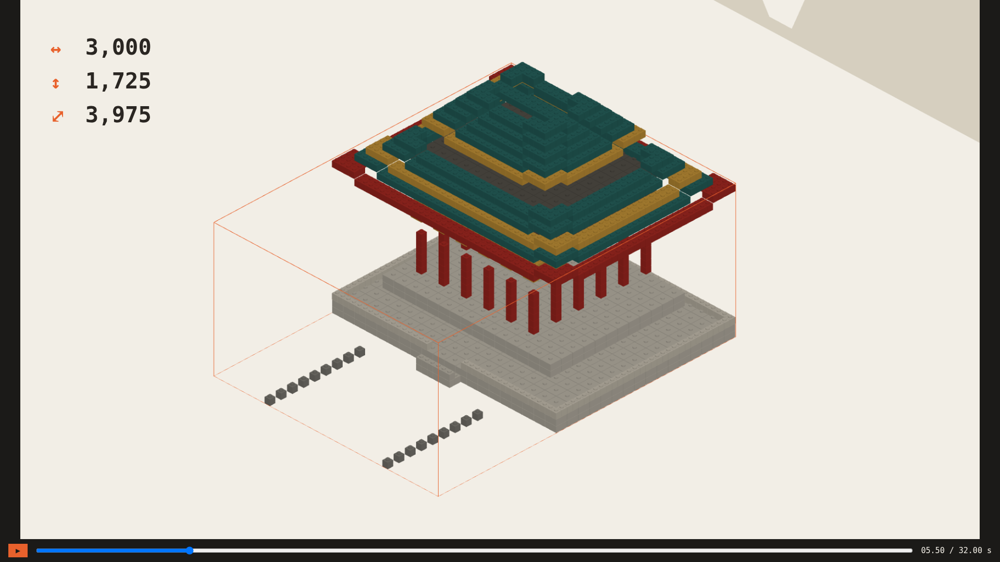
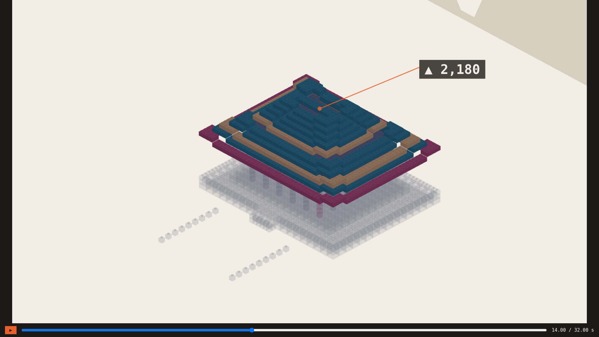
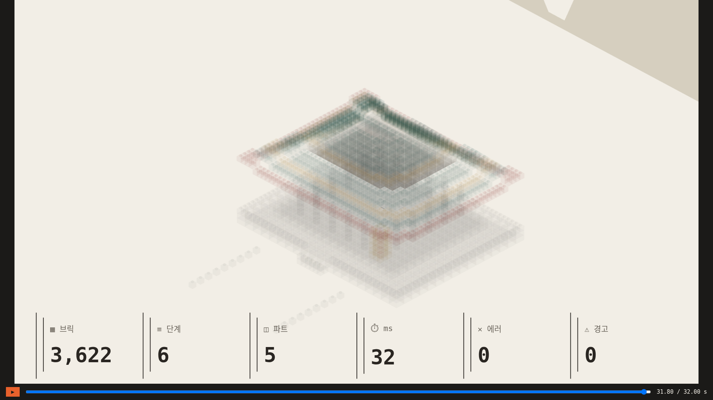
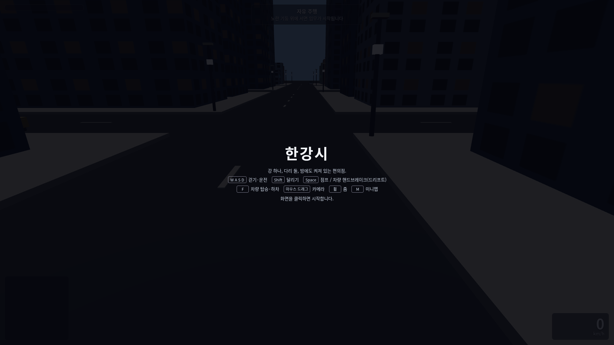
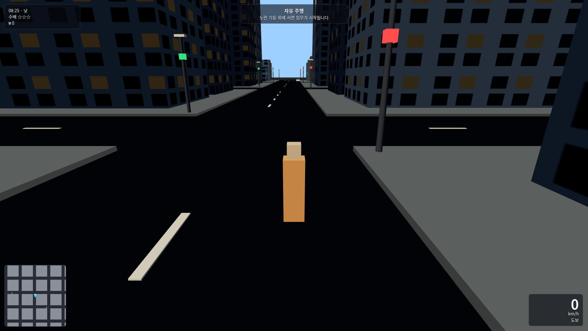
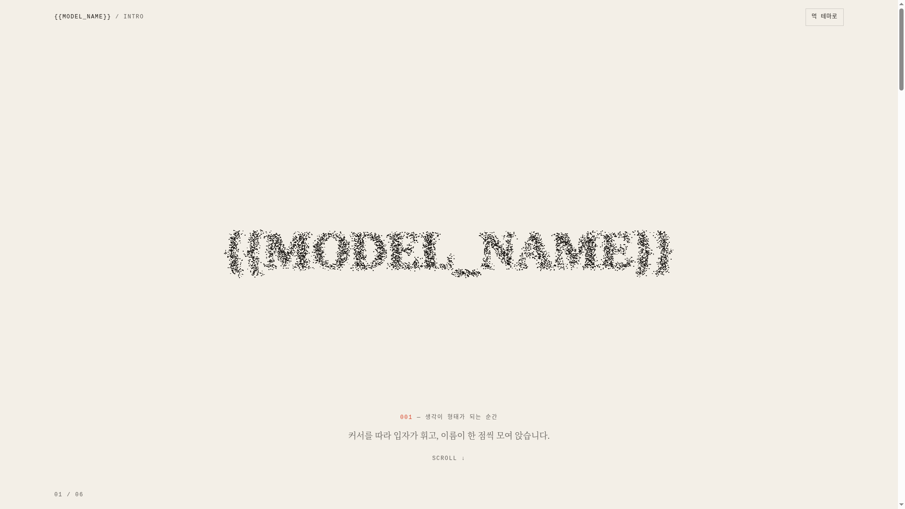
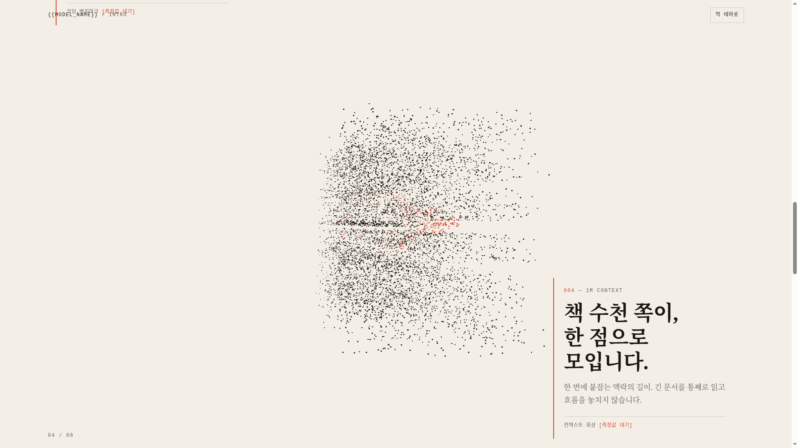
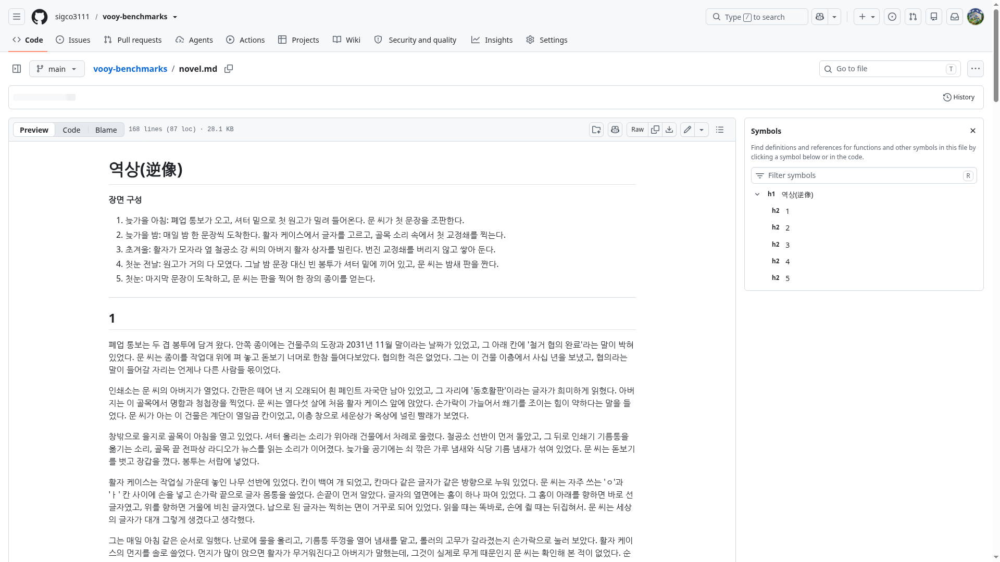
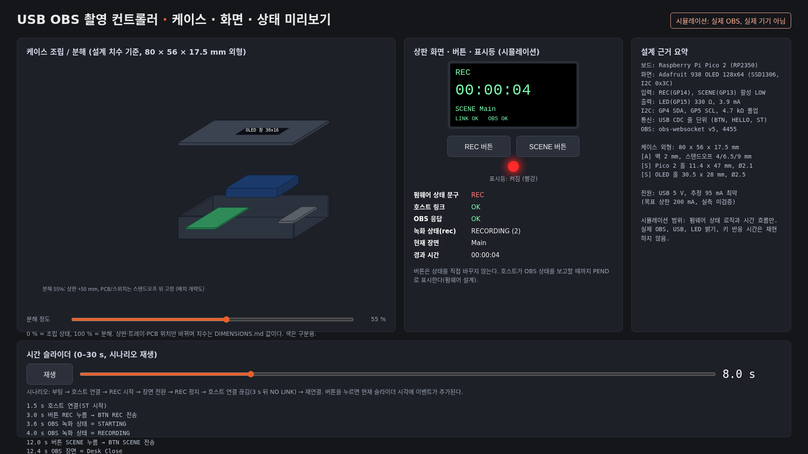
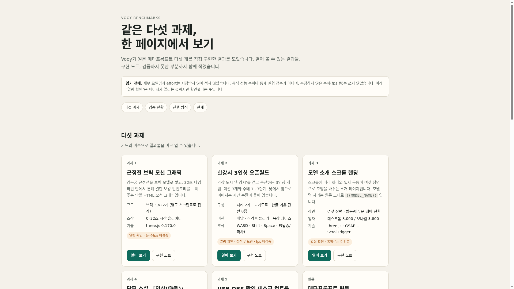

# Vooy Benchmarks | 부이 벤치마크

Vooy(AI 비서)가 같은 다섯 과제를 직접 구현한 결과와 검증 기록을 모아 둔 저장소입니다.

- 과제 원문: 유튜버 코드팩토리의 메타프롬프트(사용자 제공). [`ORIGINAL_PROMPTS.txt`](ORIGINAL_PROMPTS.txt)에 자리표시자(`{{MODEL_NAME}}`, `{{EFFORT}}`, `{{TASK_DIR}}`)까지 그대로 보존했습니다.
- 세부 모델명과 effort는 지정받지 않았고, 추정해서 쓰지 않았습니다.
- 공식 성능 순위나 통제 실험 점수가 아닙니다. 점수·순위·fps 같은 수치는 측정하지 않은 한 적지 않았습니다.
- 저장소 구조는 sigco3111/instinct-benchmarks의 폴더 구조를 참고했고, 그 저장소의 스크린샷·결과물은 열어 보거나 참고하지 않았습니다.

## 실행 주체와 방식

| 항목 | 내용 |
|---|---|
| 실행 주체 | Vooy (모델명·effort 미지정) |
| 과제 출처 | README 원문 메타프롬프트(ORIGINAL_PROMPTS.txt) |
| 실행 환경 | 파일 읽기·쓰기만 가능한 작업 환경. 브라우저 실행, 컴파일, 3D 출력은 하지 못함 |
| 결과 반영 | 작업 환경에서 쓴 파일을 GitHub 웹 편집기로 옮겨 커밋(크기 대조) |
| 실행 화면 검증 | 2026-11-19 마무리 작업에서 Instinct가 Chrome(1920×1080)으로 네 웹 결과물을 직접 실행해 확인·촬영 |

## 데모 (GitHub Pages)

배포 주소: https://sigco3111.github.io/vooy-benchmarks/

- 과제 1 근정전: https://sigco3111.github.io/vooy-benchmarks/palace.html
- 과제 2 한강시: https://sigco3111.github.io/vooy-benchmarks/hangang-city.html
- 과제 3 소개 페이지: https://sigco3111.github.io/vooy-benchmarks/model-intro.html (원문 지시대로 `{{MODEL_NAME}}` 자리표시자가 그대로 보입니다)
- 과제 5 미리보기(시뮬레이션): https://sigco3111.github.io/vooy-benchmarks/hardware/preview/index.html

네 주소 모두 실제 브라우저에서 열어 동작을 확인했습니다(아래 실행 화면 참고). fps는 재지 않았습니다.

## 실행 화면

### 과제 1 · 근정전 브릭 모션 그래픽

0–7초 구간: 주황 바운딩 박스와 실측 치수 카운트업 위로 모델이 층별로 분해됩니다.

13–17초 구간: 지붕만 남기고 모노톤으로 돌아가 지시선과 브릭 수(2,180)를 표시합니다.

29–32초 구간의 하단 통계 6칸. 브릭 3,622 · 단계 6 · 파트 5 · 생성 32ms · 에러 0 · 경고 0을 코드가 직접 집계해 표시합니다. 시간 슬라이더로 임의 시점 이동과 재생·일시정지를 확인했고, 콘솔 오류는 없었습니다. 파트별 집계(월대 1,152 · 기둥 168 · 공포 104 · 지붕 2,180 · 마당 18)가 화면 표시와 일치합니다.

### 과제 2 · 한강시 3인칭 오픈월드

시작 화면 뒤로 야간 도시가 실시간 렌더링됩니다. 화면 클릭으로 시작합니다.

W 키 전진으로 12km/h 도보 이동, 미니맵 위치 갱신, 신호등 전환, 게임 내 시간(08:10→08:25 낮)이 흐르는 것을 확인했습니다. 콘솔 오류는 없었습니다. 차량 탑승, 미션 3종의 진행, fps는 확인하지 못했습니다.

### 과제 3 · 모델 소개 스크롤 랜딩

입자가 모여 `{{MODEL_NAME}}` 글자를 조립하는 히어로 장면(1/6). 자리표시자는 원문 지시대로 그대로입니다.

스크롤에 따라 입자 구름이 책 더미에서 한 점으로 모이는 4/6 장면. 장면 전환과 테마 전환 버튼이 동작하고 콘솔 오류는 없었습니다. 모바일 배치와 fps는 확인하지 못했습니다.

### 과제 4 · 단편 소설 「역상(逆像)」

장면 구성 요약과 다섯 장면 본문 전체가 [novel.md](novel.md)에 있습니다. 공백 포함 11,954자(약 59.8매)로 집계했습니다. 문장 품질은 자체 판단이며 외부 검수는 없습니다.

### 과제 5 · USB OBS 촬영 데스크 컨트롤러

웹 미리보기에서 케이스 분해(55%)와 시나리오 재생을 확인했습니다. 8.0초 지점: 호스트 연결 후 REC 버튼 전송 → OBS 녹화 상태 RECORDING, OLED에 `REC 00:00:04 / SCENE Main / LINK OK / OBS OK`가 표시됩니다. 시뮬레이션일 뿐 실제 OBS·실물 기기 동작은 아니며, 펌웨어 컴파일·호스트 시험·STL 생성·실물 제작은 확인하지 못했습니다.

### 한눈에 보기 페이지

다섯 과제 카드와 검증 현황을 한 페이지에 모은 [랜딩 페이지](https://sigco3111.github.io/vooy-benchmarks/)입니다.

## 과제별 결과

| # | 과제 | 결과물 | 구현 노트 | 실행 검증 |
|---|---|---|---|---|
| 1 | 근정전 브릭 모션 그래픽 | [palace.html](palace.html) | [palace-NOTES.md](palace-NOTES.md) | 브라우저 실행·슬라이더 탐색 확인 (2026-11-19), fps 미측정 |
| 2 | 한강시 3인칭 오픈월드 게임 | [hangang-city.html](hangang-city.html) | [hangang-city-NOTES.md](hangang-city-NOTES.md) | 시작·도보 조작·시간 순환 확인 (2026-11-19), 미션·차량·fps 미검증 |
| 3 | 모델 소개 스크롤 랜딩 | [model-intro.html](model-intro.html) | [model-intro-NOTES.md](model-intro-NOTES.md) | 장면 전환·테마 동작 확인 (2026-11-19), 모바일·fps 미검증 |
| 4 | 을지로 인쇄소 단편 소설 「역상」 | [novel.md](novel.md) | [novel-NOTES.md](novel-NOTES.md) | 글자 수 집계함(공백 포함 11,954자, 약 59.8매) |
| 5 | USB OBS 촬영 데스크 컨트롤러 | [hardware/](hardware/) | [hardware/README.md](hardware/README.md), [hardware/VERIFICATION.md](hardware/VERIFICATION.md) | 미리보기 시뮬레이션 실행 확인 (2026-11-19). 컴파일·실물·STL 미검증 |

각 과제의 원문 요구 대비 점검표(충족/부분/미흡)는 구현 노트에 있습니다.

## 검증 기록 (솔직한 기록)

2026-11-19에 Instinct가 Chrome(1920×1080)에서 네 웹 결과물을 직접 실행해 아래를 확인했고, 스크린샷을 [`screenshots/`](screenshots/)에 보관합니다. Vooy의 작업 환경에서는 브라우저 실행이 불가능해, 이 날짜 이전 기록은 정적 검토가 기준이었습니다.

- 과제 1: 32초 타임라인 재생, 임의 시점 탐색, 단계 전환(분해→와이어프레임→지붕 집중→기둥 보강→인벤토리→통계) 확인. 최종 통계 브릭 3,622·파트 5·에러 0·경고 0 표시 확인. 콘솔 오류 없음. fps와 1920×1080 외 해상도는 미측정.
- 과제 2: 시작 화면 클릭 진입, W 전진 도보 이동(12km/h 표시), 미니맵 갱신, 게임 내 시간 경과(08:10→08:25), 신호등 상태 전환 확인. 콘솔 오류 없음. 알려진 한계(보행자가 차량에 반응하지 않음, 순찰차 경로가 막힐 수 있음)는 노트 그대로이며, 차량 탑승·미션 진행·fps는 미검증.
- 과제 3: 히어로 입자 조립, 스크롤에 따른 장면 전환(4/6 장면까지), 밝은/어두운 테마 버튼 동작 확인. 콘솔 오류 없음. 모바일 배치·fps 미검증. 성능 수치 자리는 `[측정값 대기]`, 모델명 자리는 `{{MODEL_NAME}}` 그대로.
- 과제 4: 문장 품질은 자체 판단이며 외부 검수는 없습니다. 이 파일은 처음 일부만 올라갔다가 전체 본문으로 교체해 커밋 기록이 두 번 남아 있습니다.
- 과제 5: 미리보기 페이지에서 케이스 조립·분해 슬라이더와 0–30초 시나리오 재생(부팅→호스트 연결→REC→장면 전환→정지→연결 끊김)을 확인했습니다. 펌웨어 컴파일, 호스트 시험 실행, OpenSCAD/STL 생성, 실물 제작은 하지 않았습니다. 부품 공식 링크가 빠진 항목은 BOM에 표시했습니다.
- 업로드 대조는 파일 크기(바이트) 일치까지만 확인했고, 글자 단위 대조는 하지 않았습니다.

## 크레딧과 라이선스

- 과제 원문: 코드팩토리 메타프롬프트(사용자 제공)
- 참고한 구조: sigco3111/instinct-benchmarks
- 사용 라이브러리(CDN 로드): three.js 0.170.0 (MIT), GSAP 3.12.5·ScrollTrigger (GSAP 표준 라이선스)
- 이 저장소의 결과물에는 외부 이미지·폰트·음원 파일이 없고, 간판·텍스처·형상은 코드로 생성했습니다.
- 저장소에는 아직 별도 라이선스 파일을 두지 않았습니다.
